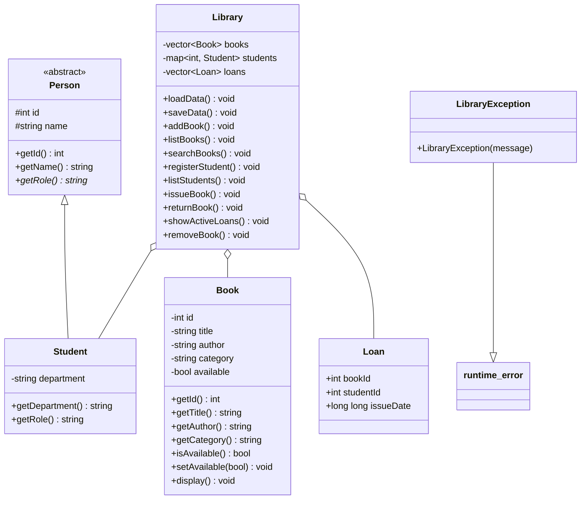

# UML Class Diagram

The following Mermaid class diagram can be rendered by GitHub in Markdown-compatible Mermaid viewers.

## Relationship explanation

- `Student` inherits from the abstract `Person` class.
- `Library` manages collections of `Book`, `Student`, and `Loan` objects.
- `Loan` connects a book with the student who borrowed it.
- `LibraryException` extends `std::runtime_error` to represent application-specific errors.
